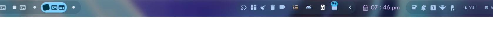

# Mac Dock Liquid Glass

A macOS Tahoe-style dock for the **Omarchy shell**: a liquid glass surface with
Hyprland backdrop blur and specular highlights, continuous fisheye
magnification, smart intelli-hide, and real window control — built with
Quickshell (QML) for Omarchy Quattro on Hyprland.



## Features

**Surface & motion**

- **Liquid glass surface** — frosted backdrop blur, dynamic tinting, specular
  highlight, adjustable glass radius, padding, and three corner shapes
  (rounded, square, pill).
- **Continuous fisheye magnification** — per-icon zoom with an optional
  Gaussian falloff, magnification raise, and fluid reflow as icons scale.
- **Border & glow controls** — a hairline ring with its own opacity and colour
  (`theme`, `accent`, `white`, `black`, or any `#rrggbb`); the glow halo picks
  up the ring's colour and has a strength slider plus a focus edge
  (full, top, bottom, left, right).

**Behaviour**

- **Smart intelli-hide** — hides while a window overlaps it and reveals on
  screen-edge pressure, with configurable hide/reveal delays and pressure size.
- **Full-screen edge hotspot** — reveal from the whole screen edge or only
  along the dock's own length.
- **Real window management** — a click launches, focuses, or minimizes
  (dash2dock model), the scroll wheel cycles through an app's windows, and the
  context menu lists every window with close / close-all and the dock settings.
- **Pinned apps, running section, and rules** — pinned items, derived running
  icons in launch order, divider rules, drag-to-reorder, and conditional items
  that appear only while a command succeeds.
- **Taskbar integration** — mirror the dock's opacity, corner shape, and border
  glow onto the Omarchy bar.
- **Icon treatment** — macOS icon theme mapping, per-icon tinting, monochrome
  mode, icon opacity and scale, hover labels and tooltips.
- **Multi-monitor aware** — the dock follows the monitor whose edge you reach
  and the monitor you summon it on.

**Settings**

- **Settings panel** — right-click the dock → **Settings**: Appearance,
  Border, Glow & Lighting, Behaviour & Interaction, and Taskbar Integration.
  Every change applies live to `shell.json` (atomic write, rolling backup).
- **CLI configurator** — `omarchy-dock-config` exposes the same settings for
  scripts and keybindings.

## Requirements

- Omarchy with the Quattro shell (Quickshell).
- Hyprland driven by the Lua config (`hyprland.lua`), so the installer can wire
  in the dock's blur and layer rules.
- No extra packages: the dock reads window and monitor state through `hyprctl`.

## Install

```bash
git clone https://github.com/omiddev9/mac-dock-liquid-glass ~/src/mac-dock-liquid-glass
cd ~/src/mac-dock-liquid-glass
./install.sh
```

The installer symlinks the plugin into `~/.config/omarchy/plugins/`, installs
`omarchy-dock-config` into `~/.local/bin`, writes `~/.config/hypr/dock.lua`
(blur and layer rules for the dock), and requires it from `hyprland.lua`. It is
safe to re-run, backs up anything it replaces, and leaves an existing dock entry
in `shell.json` alone unless you pass `--replace-config` (`--dry-run` prints the
planned actions).

Installing through the plugin manager works too, but the second step is still
required because the Hyprland rules and the configurator live outside the plugin
folder:

```bash
omarchy plugin add https://github.com/omiddev9/mac-dock-liquid-glass.git --enable
~/.config/omarchy/plugins/io.github.omiddev9.mac-dock-liquid-glass/install.sh
```

## Usage

- **Click** an icon to launch it, focus it, or minimize it when it is already
  focused.
- **Scroll** on a running icon to cycle through that app's windows.
- **Right-click** for the context menu: window list, close / close all, and
  dock settings.
- **Drag** a pinned icon to reorder the dock.
- **Push the screen edge** to reveal a hidden dock.

The dock can also be driven over IPC, so a keybinding can summon it:

```bash
omarchy-shell io.github.omiddev9.mac-dock-liquid-glass toggle
omarchy-shell io.github.omiddev9.mac-dock-liquid-glass show
omarchy-shell io.github.omiddev9.mac-dock-liquid-glass hide
omarchy-shell io.github.omiddev9.mac-dock-liquid-glass launch 3   # 1-based slot
omarchy-shell io.github.omiddev9.mac-dock-liquid-glass state      # reveal / debug state
omarchy-shell io.github.omiddev9.mac-dock-liquid-glass geometry   # layout numbers
```

## Configuration

All settings live in the plugin's entry in `~/.config/omarchy/shell.json`. The
settings panel and the CLI edit that single source of truth, and the shell
reloads the dock as soon as the file is saved.

```bash
omarchy-dock-config --help

omarchy-dock-config set borderColor '"#7dd3fc"'
omarchy-dock-config set borderOpacity 0.6
omarchy-dock-config set cornerShape '"pill"'
omarchy-dock-config set magnify true
omarchy-dock-config opacity 40%
omarchy-dock-config pin kitty 0
omarchy-dock-config move 0 3
```

Dock-level keys accepted by `set` (`"null"` removes a key and restores the
built-in default):

`align`, `animation`, `autohide`, `backgroundOpacity`, `border`,
`borderColor`, `borderOpacity`, `cornerRadius`, `cornerShape`, `dodge`, `edge`,
`edgeGap`, `fullWidth`, `gaussianZoom`, `glass`, `glassColor`, `glassEdge`,
`glassRadius`, `glassTint`, `glyphColor`, `glyphScale`, `hideDelay`,
`hotspotFullWidth`, `hotspotHeight`, `iconOpacity`, `iconSize`, `labels`,
`macIconTheme`, `macIcons`, `magnify`, `matchBarCorners`, `matchBarGlow`,
`matchBarOpacity`, `monochrome`, `padding`, `pressure`, `revealDelay`,
`runningIndicator`, `showRunning`, `showWhenEmpty`, `spacing`, `tileInset`,
`tileOpacity`, `tileRadius`, `tiles`, `tintIcons`, `tintRunning`, `tooltips`,
`zoom`, `zoomRaise`.

Pinned items in `items[]` are edited with `pin`, `unpin`, `move`, `add`, and
`set-item`:

```json
{ "desktop": "kitty" }
{ "exec": "nwg-look", "glyph": "󰒓", "label": "Appearance" }
{ "showApps": true }
{ "trash": true }
{ "spacer": true }
{ "when": "test -e /tmp/do-not-disturb" }
```

## Update

```bash
cd ~/src/mac-dock-liquid-glass && git pull && ./install.sh
omarchy-shell -q shell rescanPlugins
```

## Remove

```bash
cd ~/src/mac-dock-liquid-glass && ./uninstall.sh
```

Only the symlinks and Hyprland lines the installer added are removed, and your
dock settings are kept; add `--purge-config` to drop the dock's `shell.json`
entry as well. If you also added the plugin through the plugin manager, remove
that copy too:

```bash
omarchy plugin remove io.github.omiddev9.mac-dock-liquid-glass
```

## Author

**Omid.Dev** — [github.com/omiddev9](https://github.com/omiddev9)

## License

MIT — see [LICENSE](LICENSE).
